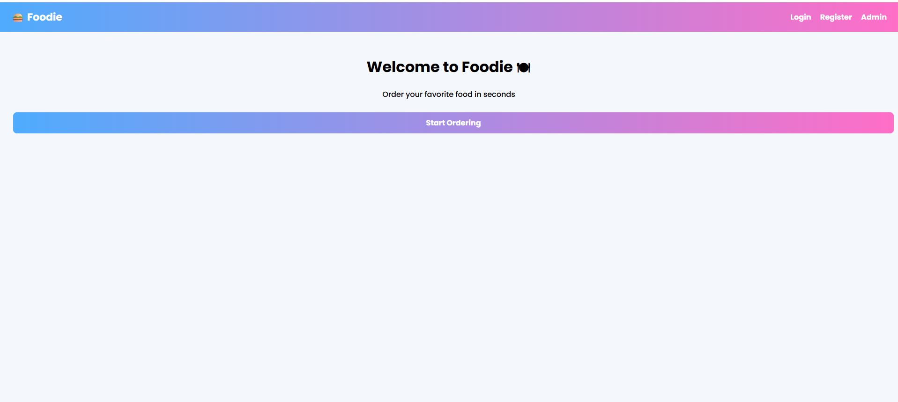
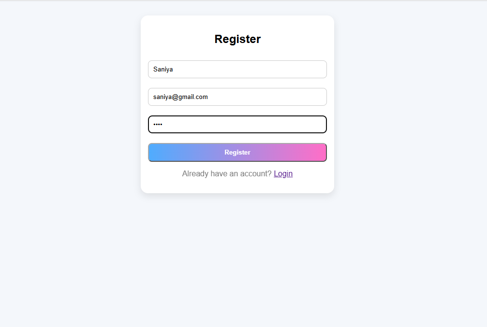
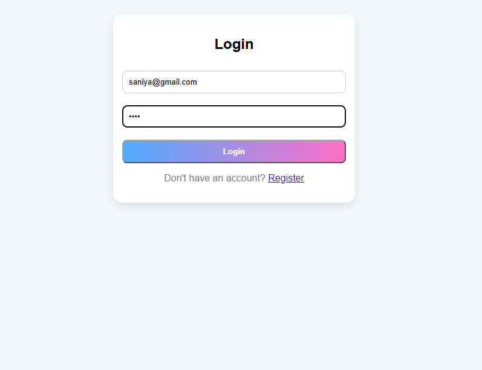
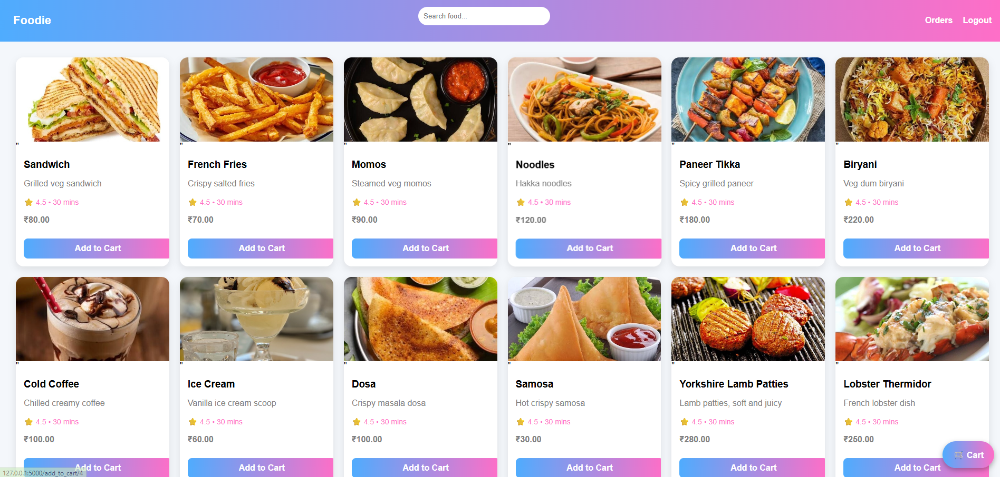
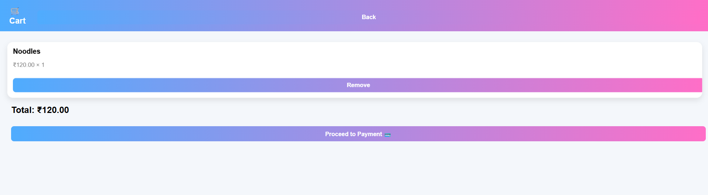
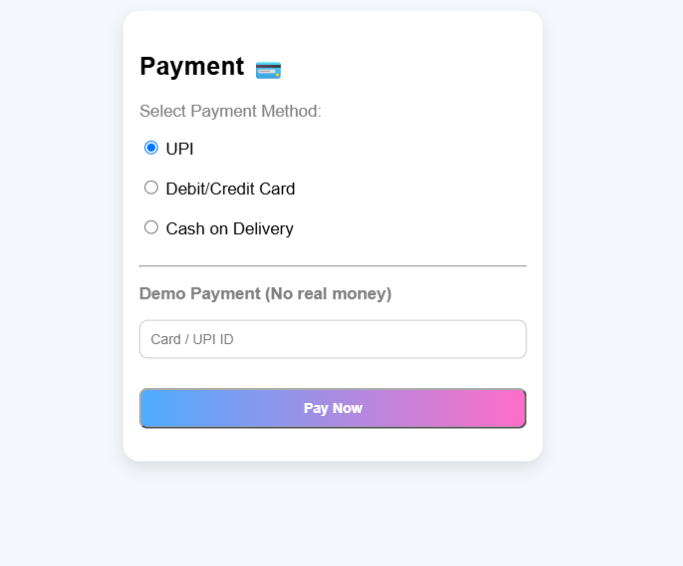
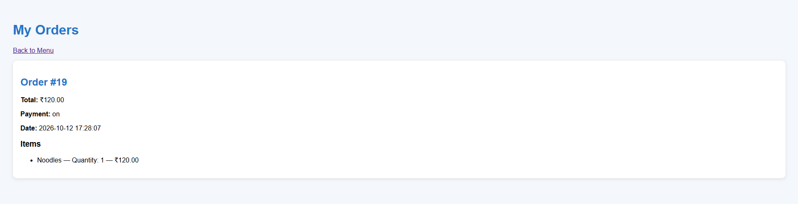

# Online Food Order Management System

A web application that lets customers browse a food menu, add items to a cart, choose a payment method, and place orders. Built with Python Flask and MySQL.

## Features

- Browse available food items
- Add and remove items from the cart
- Place orders with order details saved to the database
- Choose from multiple payment methods
- Relational database design using foreign keys

## Tech Stack

| Layer     | Technology                 |
|-----------|----------------------------|
| Frontend  | HTML, CSS, JavaScript      |
| Backend   | Python (Flask)             |
| Database  | MySQL                      |
| Connector | mysql-connector-python     |

## Database Tables

- `food`: menu items and prices
- `cart`: items a customer has added
- `order_details`: placed orders and their items
- `payment_methods`: available payment options

Tables are linked using foreign keys. The full schema is in `schema.sql`.

## Project Structure

```
online-food-order-system/
├── app.py
├── schema.sql
├── templates/
├── static/
└── README.md
```

## Setup and Installation

1. **Clone the repository**
   ```
   git clone https://github.com/<your-username>/online-food-order-system.git
   cd online-food-order-system
   ```

2. **Install dependencies**
   ```
   pip install flask mysql-connector-python
   ```

3. **Create the database**
   ```
   mysql -u root -p
   CREATE DATABASE food_order;
   USE food_order;
   SOURCE schema.sql;
   ```

4. **Update database credentials** in `app.py`:
   ```python
   mysql.connector.connect(
       host="localhost",
       user="root",
       password="your_password",
       database="food_order"
   )
   ```

5. **Run the app**
   ```
   python app.py
   ```
   Open `http://127.0.0.1:5000` in your browser.

## Screenshots








## Future Improvements

- Admin panel to manage menu items
- Order tracking and history
- Sales analytics dashboard

## Author

**Saniya Shaikh**
3rd-year B.E. student, AI & Data Science
GitHub: [your-username](https://github.com/your-username)
LinkedIn: [your-profile](https://linkedin.com/in/your-profile)
